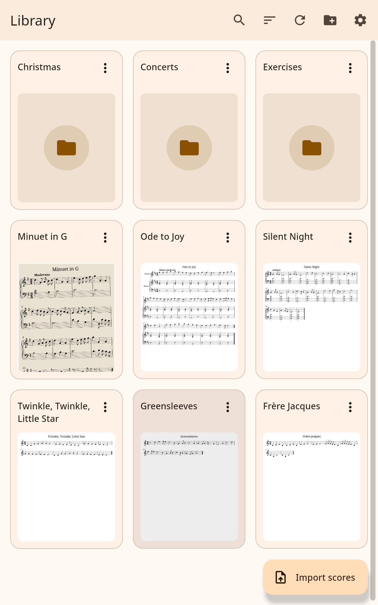
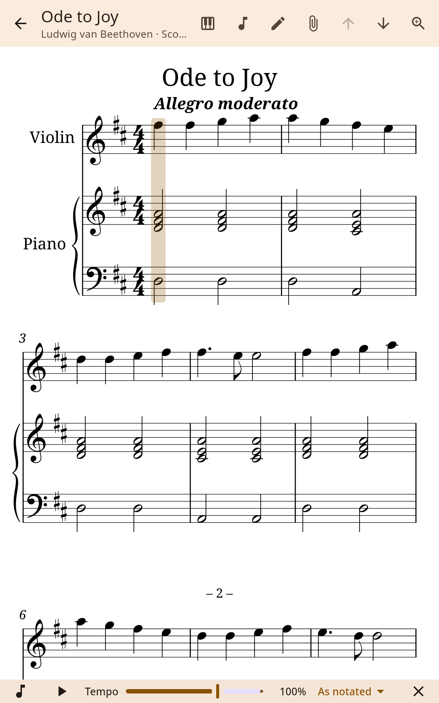
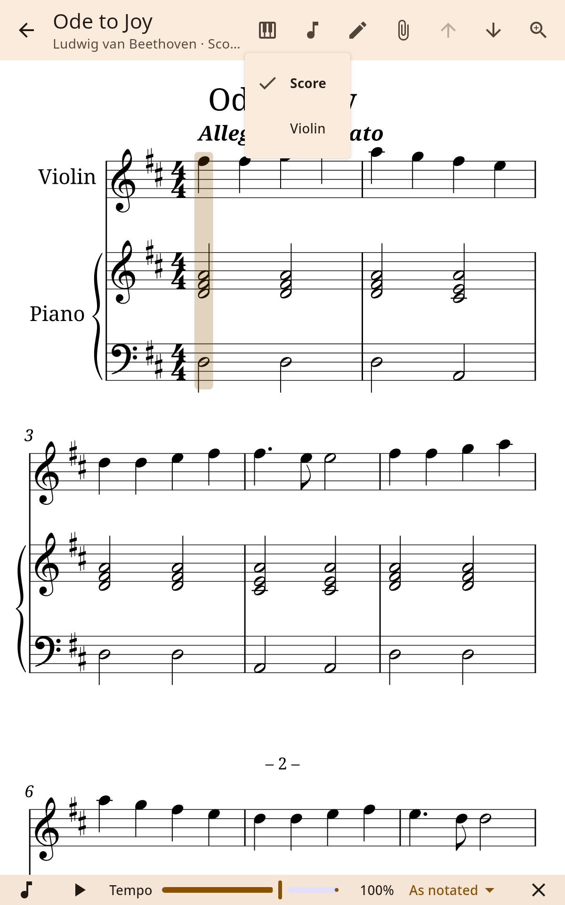
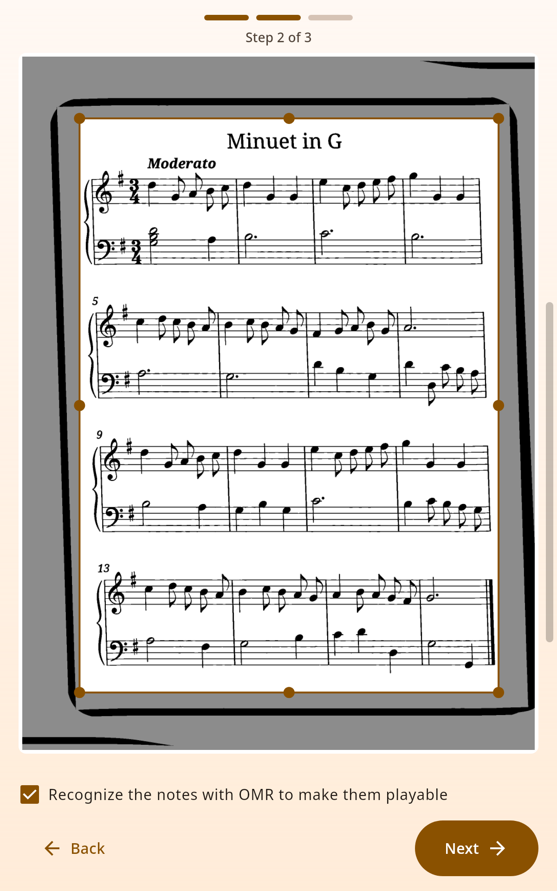
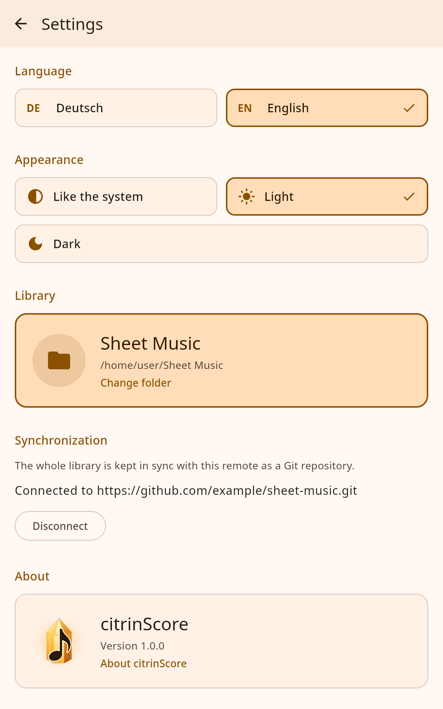
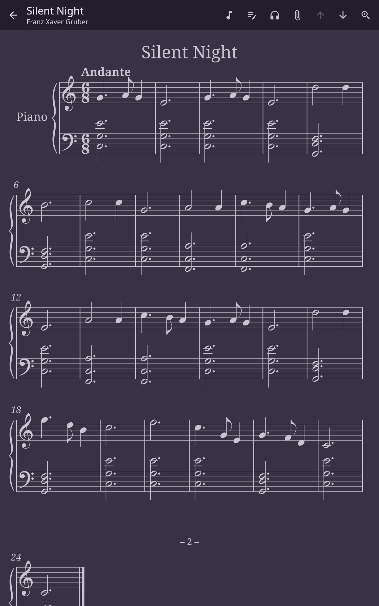

# citrinScore

citrinScore is a free, open-source sheet music library for tablets, phones and desktop computers. It keeps your scores as
plain folders on your own storage, so there is no account, no cloud and no lock-in.

The app is built with Kotlin Multiplatform and Compose Multiplatform and runs on Android, Linux, Windows and macOS.
The shared code base is prepared for iOS.

## Screenshots

<table>
  <tr>
    <td align="center"><br>Library</td>
    <td align="center"><br>MusicXML with audio player</td>
    <td align="center"><br>Playback</td>
    <td align="center"><br>Parts</td>
  </tr>
  <tr>
    <td align="center"><br>Notes on a PDF score</td>
    <td align="center"><br>Import wizard</td>
    <td align="center"><br>Settings</td>
    <td align="center"><br>Dark theme</td>
  </tr>
</table>

## Features

- **Library** – browse a folder of your choice, organise scores in sub folders, search and sort them, delete scores and
  folders.
- **Parts** – a score can hold several parts, for example one per instrument, each imported from its own images, PDF or
  MusicXML file. The viewer switches between them and remembers the last one.
- **Editing** – add, rename, reorder or remove parts, reorder, remove or add pages and change title, composer and
  description.
- **Import wizard**
  - **Images** (PNG, JPG, WebP, BMP, SVG): one or more pages, reorderable, rendered as vectors for SVG.
  - **PDF**: a single document, rendered page by page.
  - **MusicXML** (`.musicxml`, `.xml`, `.mxl`): engraved with Verovio and laid out to fit the screen. Zooming reflows the
    music instead of scaling it.
  - **Scan**: take photos with the camera on Android/iOS, or pick scanned images and PDFs on desktop. Pages are converted
    to clean black and white with an adaptive threshold that can be tuned with a slider.
  - White margins are cropped automatically, previews show the result before importing.
- **Viewer**
  - Continuous vertical page layout with smooth zooming (pinch, mouse wheel, zoom slider) and panning.
  - Sharp rendering at every zoom level: only the visible area is re-rendered at the current resolution.
  - Previous/next page buttons that page by staff systems, so a partly visible system moves to the top instead of being cut.
  - Keyboard and Bluetooth page turner support (Page Up/Down, arrow keys, space, +/-).
  - Notes on the score: draw with finger, stylus or mouse and place text, with eraser and undo. On MusicXML parts notes
    stick to their measures when the music reflows.
- **Playback** – MusicXML parts can be played with a built-in General MIDI synthesizer. A cursor follows the music, the
  sounding notes are highlighted and the view scrolls along. Tap a note to hear it and to start from there, the tempo can
  be changed while playing and the part can be played with another instrument sound.
- **Play along** – the microphone listens while you play a MusicXML part on your instrument. The cursor waits on the next
  note and moves on as soon as you play it, so you always see where you are. It follows one voice at a time, any note of
  a chord counts.
  - Follows the app theme: in the dark theme the score is recoloured to the theme's paper and text colours.
  - The screen stays on while a score is open.
  - Zoom level and position are remembered per score.
- **Audio attachments** – attach WAV or MP3 files or record with the microphone and play them back in a slim bar at the
  bottom of the score while reading it.
- **File attachments** – keep any related file with a score, for example MuseScore or MusicXML files, and save it again
  with "Save as".
- **Synchronization** – keep the whole library in a Git repository (for example on GitHub, GitLab or Gitea) and
  synchronize it between devices with one button. Local changes are committed, remote changes pulled and the result
  pushed. When a score was changed on both sides, you choose per score whether to keep the local or the remote version,
  or cancel the synchronization. Zoom, position and the last opened part stay on each device.
- **Settings** – language (English, German), light/dark/system theme, library location, Git repository URL and access
  token for synchronization.

## Supported platforms

| Platform | Status |
|---|---|
| Android 8.0 (API 26) and newer | supported |
| Linux, Windows, macOS (JVM desktop) | supported |
| iOS | shared code compiles, no app project yet, no MusicXML, playback, play along or synchronization |

## Score format

Every score is a directory with the suffix `.citscore`, so it can be copied, synced and backed up like any other folder. A score holds one or more parts, for example one per instrument, each in its own directory:

```
Etude.citscore/
├── manifest.json            metadata and the parts with their page lists, crop boxes, staff system positions and attachments
├── device.json              last opened time, selected part and view state of this device, not synchronized
├── thumbnail.jpg            preview of the first part used by the library
└── parts/<id>/
    ├── annotations.json     drawings and text notes, in page coordinates or anchored to measures for MusicXML
    ├── pages/001.png        original images (image and scan imports)
    ├── score.pdf            original document (PDF imports)
    ├── score.musicxml       original file (MusicXML imports, also .xml or .mxl)
    ├── audio/               audio attachments (WAV, MP3)
    └── files/               other attached files
```

Scores created before parts existed keep their single part directly in the score directory.

Unknown keys in `manifest.json` are ignored, missing optional values are recomputed when a score is opened. View state
found in older manifests is moved to `device.json`.

When synchronization is set up, the library folder is a Git repository. Its `.gitignore` excludes the `device.json`
files, and empty folders get a `.gitkeep` file so that they are synchronized as well. On Android, synchronization needs
the "All files access" permission, because Git works on plain files and the library folder has to be on the device
storage.

## Building

Requirements:

- JDK 17 or newer to start Gradle. Gradle provisions JDK 25 for the build automatically.
- Android SDK with platform 37 and the NDK and CMake versions from `gradle.properties` for the Android app (configure
  `sdk.dir` in `local.properties` or `ANDROID_HOME`).
- CMake 3.24 or newer and a C++20 compiler to build Verovio and FluidSynth for the desktop.
- The third party sources, checked out as git submodules: `git submodule update --init --recursive`.
- `dpkg-deb` and `rpmbuild` to package the desktop app on Linux, since jpackage builds both a `.deb` and an `.rpm`
  (on Arch Linux: `pacman -S dpkg rpm-tools`).

All versions are defined in [`gradle.properties`](gradle.properties).

| Task | Command |
|---|---|
| Run the desktop app | `./gradlew :desktopApp:run` |
| Package the desktop app for the current OS | `./gradlew :desktopApp:packageReleaseDistributionForCurrentOS` |
| Build the Android app | `./gradlew :androidApp:assembleRelease` |
| Run the tests | `./gradlew :shared:jvmTest` |

The installers for Linux (`.deb`, `.rpm`), Windows (`.msi`) and macOS (`.dmg`) are built by the
[Package](.github/workflows/package.yml) workflow on GitHub Actions. Start it manually and choose a platform or all of them.
The macOS package is not signed, so macOS asks for confirmation when it is opened for the first time.

The desktop app keeps its settings and extracted resources in `~/.citrinscore`. Start it with
`-Dcitrinscore.home=/absolute/path` to use another directory, for example a separate test library during development.

The release build of the Android app is signed with the debug key for local testing. Replace the signing configuration in
[`androidApp/build.gradle.kts`](androidApp/build.gradle.kts) before publishing to a store.

## Project structure

| Module | Content |
|---|---|
| `shared` | UI, view models, rendering, import and storage for all platforms |
| `androidApp` | Android entry point |
| `verovio` | Android library that builds the native Verovio engraver with the NDK |
| `fluidsynth` | Android library that builds the native FluidSynth synthesizer with the NDK |
| `desktopApp` | Desktop entry point and packaging |
| `branding` | App icon source and the script that generates all platform icons |

Source sets in `shared`:

| Source set | Platforms | Used for |
|---|---|---|
| `commonMain` | all | almost everything |
| `skikoMain` | desktop, iOS | Skia based image rendering |
| `jvmAndroidMain` | desktop, Android | Verovio and FluidSynth bindings through JNA |
| `mobileMain` | Android, iOS | camera capture |
| `androidMain`, `jvmMain`, `iosMain` | one each | PDF rendering, audio, platform integration |

## Libraries

- [Compose Multiplatform](https://www.jetbrains.com/compose-multiplatform/) and Material 3
- [FileKit](https://github.com/vinceglb/FileKit) for file and folder access, pickers and the camera
- [kotlinx.serialization](https://github.com/Kotlin/kotlinx.serialization) for the manifest and settings
- [Apache PDFBox](https://pdfbox.apache.org/) for PDF rendering on desktop
- [AndroidSVG](https://github.com/BigBadaboom/androidsvg) for SVG rendering on Android
- [Apache Batik](https://xmlgraphics.apache.org/batik/) for SVG rendering on desktop
- [Verovio](https://www.verovio.org/) for engraving MusicXML, called through [JNA](https://github.com/java-native-access/jna)
- [FluidSynth](https://www.fluidsynth.org/) for playback, with the [GeneralUser GS](https://www.schristiancollins.com/generaluser)
  sound font by S. Christian Collins
- [ktmidi](https://github.com/atsushieno/ktmidi) for reading the MIDI export of Verovio
- [JGit](https://www.eclipse.org/jgit/) for synchronizing the library with a Git repository
- [JLayer and MP3SPI](https://github.com/pdudits/soundlibs) for MP3 playback on desktop

Audio playback and recording use the platform APIs (Java Sound, Android MediaPlayer/AudioTrack/AudioRecord, AVFoundation).
Pitch detection for play along uses the YIN algorithm.

## License

citrinScore is licensed under the [GNU General Public License v3.0](LICENSE).
