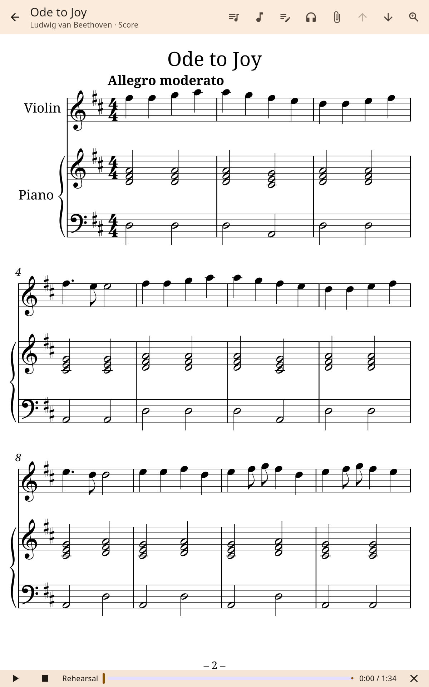
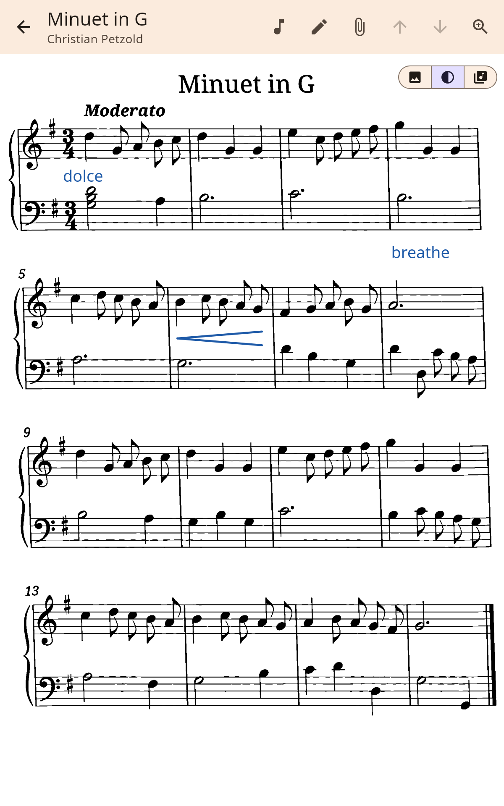

# citrinScore

citrinScore is a free, open-source sheet music library for tablets, phones and desktop computers. Your scores stay on
your own device as plain files: no account, no cloud, no lock-in.

<table>
  <tr>
    <td align="center"> Library</td>
    <td align="center"> MusicXML with audio player</td>
    <td align="center"> Playback</td>
    <td align="center"> Parts</td>
  </tr>
  <tr>
    <td align="center"> Notes on a PDF score</td>
    <td align="center"> Import wizard</td>
    <td align="center"> Settings</td>
    <td align="center"> Dark theme</td>
  </tr>
</table>

## Features

- **Import** images, SVGs, PDFs and MusicXML, or scan pages with the camera. Margins are cropped automatically.
- **Parts** – keep several parts per score, for example one per instrument.
- **Viewer** with smooth zooming, page turning by staff systems and support for keyboards and Bluetooth page turners.
- **Notes** – draw and write on your scores with finger, stylus or mouse.
- **Playback** – listen to MusicXML scores while a cursor follows the music. Change the tempo or the instrument sound.
- **Play along** – play on your instrument and the cursor follows you through the microphone.
- **Audio and files** – record yourself, attach MP3 or WAV files and keep related files with each score.
- **Synchronization** – keep your library up to date on all your devices with a Git repository.
- Organise scores in folders, search and sort them, light and dark theme, English and German.

## Installation

Download the package for your system from the [releases](https://github.com/MatWein/CitrinScore/releases) page.

| System | File | Notes |
|---|---|---|
| Android 8.0 or newer | `citrinScore-<version>.apk` | Allow installing apps from your browser or file manager when Android asks. |
| Windows | `citrinScore-<version>.msi` | Windows SmartScreen may warn because the installer is not signed ("More info" → "Run anyway"). |
| macOS (Apple silicon) | `citrinScore-<version>.dmg` | If macOS refuses to open the app, allow it under System Settings → Privacy & Security. |
| Debian, Ubuntu | `citrinscore_<version>-1_amd64.deb` | `sudo apt install ./citrinscore_<version>-1_amd64.deb` |
| Fedora, openSUSE | `citrinscore-<version>-1.x86_64.rpm` | `sudo dnf install ./citrinscore-<version>-1.x86_64.rpm` |
| Arch Linux | `citrinscore-bin-<version>-1-x86_64.pkg.tar.zst` | `sudo pacman -U citrinscore-bin-<version>-1-x86_64.pkg.tar.zst` |
| Other Linux | `citrinScore-<version>-linux-x86_64.tar.gz` | Extract it anywhere and start `citrinScore/bin/citrinScore`. |

## Where your scores are stored

You choose the library folder when you start the app for the first time and can change it later in the settings. Your
scores move along to the new location.

On Android you can keep the library either in the app or in a folder of your choice. Synchronization only works when
the library is stored in the app. Keep in mind that Android removes the app's data when the app is uninstalled.

## Synchronization

Create an empty repository at a Git host such as GitHub, GitLab or Gitea and an access token that may write to it. Enter
the repository URL and the token in the settings and press the sync button in the library. When a score was changed on
two devices, you choose which version to keep.

## Development

How to build the app, the score format and the release process are described in [DEVELOPMENT.md](DEVELOPMENT.md).

## License

citrinScore is licensed under the [GNU General Public License v3.0](LICENSE). The libraries, fonts and the sound font it
uses keep their own licenses, which are listed in the app under Settings → About.
